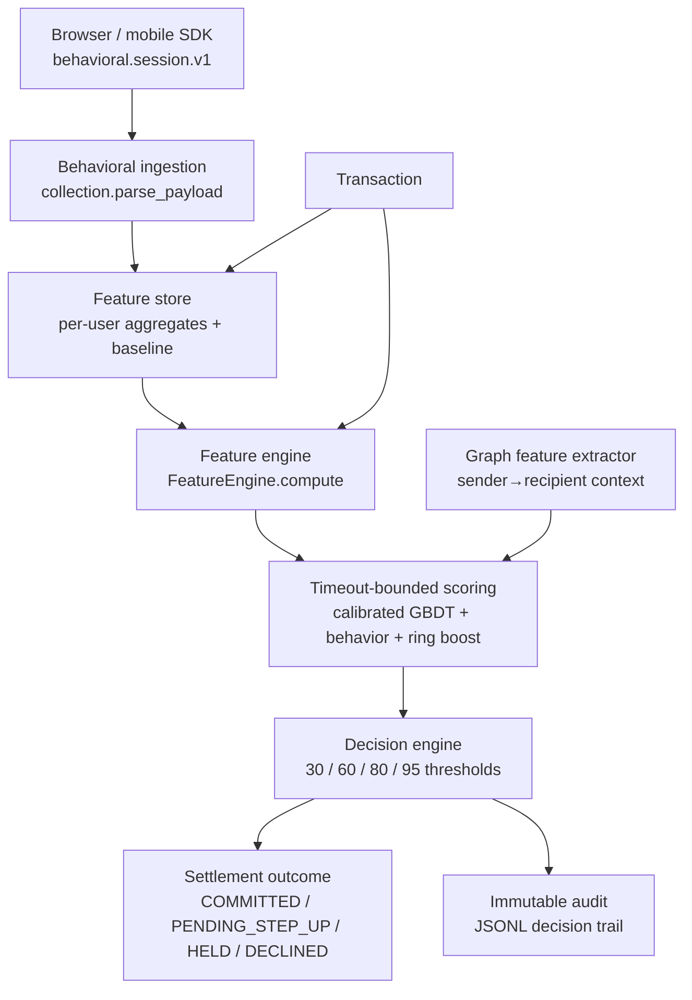
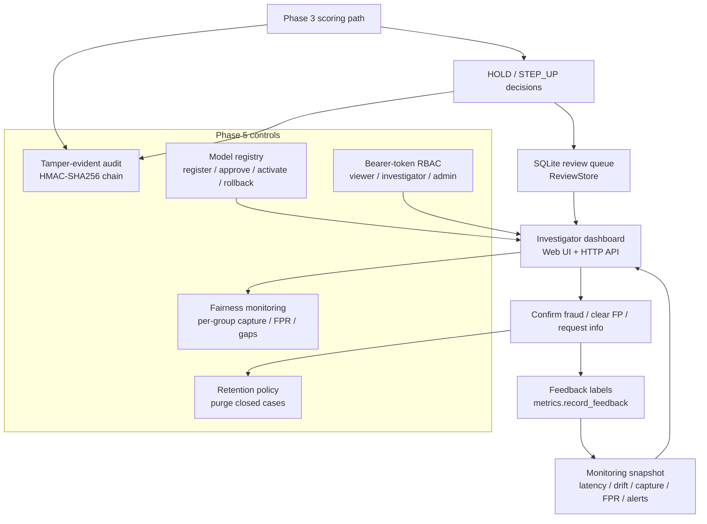
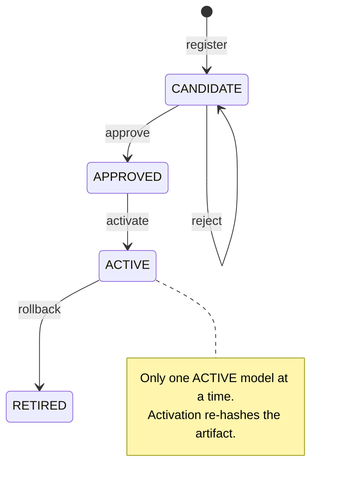
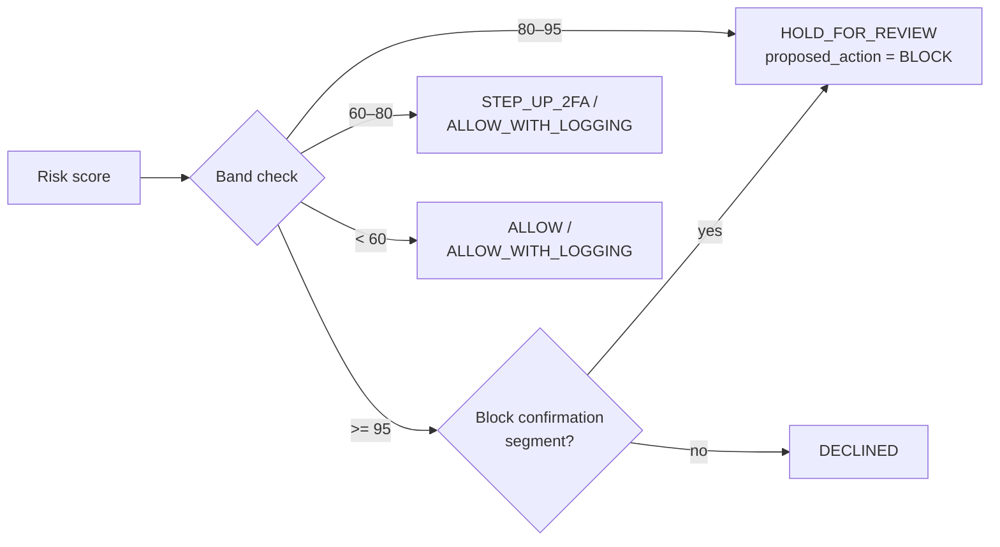

# Z-Sentinel — Real-Time Payment Fraud Detection with Behavioral Biometrics

Cross-platform fraud detection reference implementation for a
standard-library-only Python fraud scoring path, plus the Phase 4/5/6
operations tooling around it. The project is shaped to run on IBM Z /
LinuxONE, but the library itself has no platform-specific code and no
third-party Python packages.

## What this is

A reference stack built end-to-end for one idea: score every payment
transaction in milliseconds, inside the transaction path, using three
signals working together:

- **Transaction context** — amount, velocity, device history, geography,
  recipient risk, and per-user rolling aggregates.
- **Behavioral biometrics** — per-session keystroke, mouse and touch
  aggregates, collected in the browser/mobile SDK and ingested
  privacy-preservingly on the server.
- **Graph-based fraud ring detection** — sender→recipient structural
  features that flag shared-recipient patterns.

The result is a 0–100 risk index, a decision (allow / log / step-up /
hold / block), a settlement outcome, a signed explanation of the top
signals, and an immutable audit entry. Phase 5 adds tamper-evident
audit chaining, bearer-token RBAC with TLS support, a model governance
registry, fairness monitoring, block confirmation by segment, and
closed-case retention. Phase 6 covers testing and operational readiness.

## Design principles

- **No wheels, no pip.** The Python path uses only the standard library.
  It is built to run on IBM Z without s390x package dependencies.
- **Real-time first.** Scoring is synchronous and timeout-bounded. The
  default policy is fail-open so a missing model never stops payments.
- **Explainable by construction.** Every score carries top contributing
  signals and the attribution method. The dashboard, audit trail and
  review cases expose the same explanation.
- **Privacy-preserving.** The SDK sends aggregates only. Customer
  identity is replaced by a salted SHA-256 reference before it ever
  reaches scoring, the review store or the audit.
- **Tamper-evident operations.** Phase 5 chains HMAC-SHA256 across every
  decision and governance event so tampering and reordering are detected.

## Architecture

The high-level flow is the same across Phase 3, Phase 4 and Phase 5:



Phase 4 and Phase 5 add the operations layer on top of that core path:



The model lifecycle is governed through an explicit approval state machine:



And the enforcement of a block decision by segment follows this path:



## Repository layout

| Path | Purpose |
|---|---|
| `fraud_detection/` | Core library: features, model, ensemble, scoring, audit, security, dashboard. |
| `fraud_detection/train.py` | Phase 2 training entry point. |
| `fraud_detection/realtime.py` | Phase 3 demo CLI: streams traffic through the full path and verifies it. |
| `fraud_detection/phase4.py` | Phase 4 demo CLI: scoring, review queue, dashboard and monitoring. |
| `fraud_detection/phase5.py` | Phase 5 demo CLI: tamper-evident audit, RBAC, registry, fairness, retention, rollback. |
| `models/fraud_model.json` | Trained model artifact. |
| `models/MODEL_CARD.md` | Model card: intended use, data, performance, limitations. |
| `dashboard/` | Static investigator dashboard: HTML, JS, CSS. |
| `sdk/behavioral-biometrics.js` | Reference browser SDK for behavioral session aggregates. |
| `config/decision-thresholds.example.json` | Example per-segment threshold config. |
| `run_phase*.sh` | Annotated launchers for each phase. |
| `tests/` | Unit and integration suites. |
| `docs/PHASE*.md` | Phase-by-phase notes, runbooks and limitations. |

## Quick start

The project needs only Python 3.10+ and no pip packages.

```bash
python3 -m fraud_detection.train --out models/fraud_model.json
python3 -m fraud_detection --model models/fraud_model.json \
    --transactions 2000 --users 200 --fraud-rate 0.03 --warmup 2000
```

Phase 3 demo:

```bash
./run_phase3.sh
```

Phase 4 operations demo:

```bash
./run_phase4.sh
python3 -m fraud_detection.phase4 --model models/fraud_model.json \
    --transactions 2000 --demo-reviews 12 --check
```

Phase 5 security and governance demo:

```bash
./run_phase5.sh
python3 -m fraud_detection.phase5 --model models/fraud_model.json \
    --transactions 1500 --demo-reviews 8 --demo-rollback --check
```

Rules-only fallback (no model needed):

```bash
python3 -m fraud_detection --transactions 500 --seed 42
```

Tests:

```bash
python3 -m unittest discover -s tests -v
```

## Core API

### Train

```bash
python3 -m fraud_detection.train \
    --events 15000 --warmup 2000 --users 200 \
    --fraud-rate 0.03 --trees 60 --depth 3 --out models/fraud_model.json
```

The trainer writes a versioned JSON artifact and a generated model card.

### Score in-process

```python
from fraud_detection.service import AuditLog, ScoringPolicy, ScoringService

with ScoringService(
    model_path="models/fraud_model.json",
    policy=ScoringPolicy(timeout_ms=50, failure_mode="fail_open"),
    audit=AuditLog("logs/phase3-decisions.jsonl"),
) as service:
    service.warm(historical_events)
    result = service.score(transaction, behavior_payload)
```

`ScoreResult` carries the risk score, action, settlement outcome, segment,
model version, top signals, per-stage latency, behavior status and
degradation details.

### Phase 4 operations

```python
from fraud_detection.phase4 import run as run_phase4

summary, store, monitor, version = run_phase4(
    transactions=2000,
    users=200,
    fraud_rate=0.03,
    warmup=2000,
    model_path="models/fraud_model.json",
    db_path="logs/phase4-reviews.sqlite",
    audit_path="logs/phase4-decisions.jsonl",
    demo_reviews=12,
)
```

The same surface is what `run_phase4.sh` and `fraud_detection.phase4`
expose with CLI flags.

### Phase 5 controls

```bash
python3 -m fraud_detection.phase5 \
    --model models/fraud_model.json \
    --transactions 1500 --demo-reviews 8 --demo-rollback --check \
    --db logs/phase5-reviews.sqlite \
    --audit-log logs/phase5-decisions.jsonl \
    --audit-key logs/phase5.key \
    --registry logs/phase5-model-registry.json \
    --tokens logs/phase5-tokens.json
```

That run exercises the secure audit chain, the model registry, bearer-token
access, case explanations, fairness monitoring, retention and the rollback
drill.

## Decision bands

| Risk score | Action | Settlement outcome |
|---|---|---|
| `< 30` | `ALLOW` | `COMMITTED` |
| `30–60` | `ALLOW_WITH_LOGGING` | `COMMITTED` |
| `60–80` + behavior anomaly | `STEP_UP_2FA` | `PENDING_STEP_UP` |
| `60–80` otherwise | `ALLOW_WITH_LOGGING` | `COMMITTED` |
| `80–95` | `HOLD_FOR_REVIEW` | `HELD_FOR_REVIEW` |
| `>= 95` | `BLOCK` | `DECLINED` |

Segment thresholds (`new_user`, `high_value`, `standard`) are configurable
through `DecisionConfig`. At the hold band, an account with 2FA enrolled is
challenged instead of held.

## Behavioral biometrics

The SDK collects session aggregates only: key hold distribution, inter-key
interval, pointer velocity and direction entropy, normalised click positions,
and touch pressure/speed/angle. It never records text, key codes, element
values or raw pointer paths.

```js
import { hashSubjectId, createCollector } from "./behavioral-biometrics.js";

const subjectRef = await hashSubjectId(customerId, serverIssuedSalt);
const collector = createCollector({ subjectRef, consent: userConsent });
collector.attach();

// at payment time
const payload = collector.snapshot();
await collector.flush("/api/fraud/behavior");
```

Server-side ingestion validates the same schema and rejects raw content,
event arrays and out-of-range metrics. A rejected or opted-out payload does
not fail the payment — the transaction is scored with transaction-only
features and the audit record notes `behavior_status: "rejected"` or
`"opted_out"`.

## Dashboard

The Phase 4/5 dashboard serves the API and the static UI from
`dashboard/`. The default URL is `http://127.0.0.1:8080` for Phase 4 and
`http://127.0.0.1:8085` for Phase 5.

| Method | Path | Purpose |
|---|---|---|
| `GET` | `/api/health` | Liveness, review count, model version |
| `GET` | `/api/cases` | Risk-sorted queue |
| `GET` | `/api/cases/{id}` | Full case evidence plus action history |
| `GET` | `/api/cases/{id}/actions` | Investigator audit trail |
| `POST` | `/api/cases/{id}/actions` | Investigator disposition |
| `GET` | `/api/metrics` | Monitoring snapshot, alerts, fairness |
| `GET` | `/api/config` | Active segment thresholds |
| `GET` | `/api/feedback` | Labeled cases for retraining |
| `GET` | `/api/models` | Registry summary (Phase 5) |
| `POST` | `/api/models/{version}/approve` | Approve a candidate (admin) |
| `POST` | `/api/models/{version}/reject` | Reject a candidate (admin) |
| `POST` | `/api/models/{version}/activate` | Serve an approved model (admin) |
| `POST` | `/api/models/rollback` | Restore previous active model (admin) |

## Security model

- **In transit:** TLS 1.2+ is available via
  `fraud_detection.security.build_server_ssl_context`. Certificate and key
  material belong in the z/OS keyring or a mounted secret, not in the repo.
- **At rest:** the application never stores PANs, CVVs or raw behavioral
  input. At-rest encryption is delegated to the platform: zFS/DB2 encryption
  with CPACF-backed key material and RACF keyrings.
- **Access:** Phase 5 bearer-token RBAC has three roles — `viewer`,
  `investigator`, `admin`. Demo token files are written with mode `0600`.
- **Audit:** `SecureAuditLog` chains SHA-256 and HMAC-SHA256 across every
  decision and governance event. Editing, deleting or reordering a record
  breaks `verify()`.

## Monitoring

`MetricsMonitor` produces a rolling snapshot of:

- action/outcome mix and risk histogram,
- scoring latency p50/p95/p99 against the configured budget,
- degraded/timeout rate,
- detection rate drift and mean score shift versus a baseline window,
- capture rate and false-positive rate once review labels exist,
- active alerts, emitted once per code to an optional alert sink,
- per-group fairness: volume, elevated rate, capture rate, false-positive
  rate, and max capture/FPR gaps.

## Testing

```bash
python3 -m unittest discover -s tests -v
```

Phase 6 validation:

```bash
./run_phase6.sh
./run_phase6.sh --unit
./run_phase6.sh --unit --only test_phase6.py
./run_phase6.sh --phase4
./run_phase6.sh --phase5
```

## Configuration

| Setting | Default | Notes |
|---|---|---|
| `FRAUD_SUBJECT_SALT` | demo salt | Must be a secret in production |
| `FRAUD_AUDIT_KEY` | none | Hex audit key for the secure chain |
| `ScoringPolicy.timeout_ms` | 50 | Transaction-path budget |
| `ScoringPolicy.failure_mode` | `fail_open` | `fail_closed` for strict policy |
| `--audit-log` | phase-specific JSONL | Append-only decision audit |

Example decision config lives in
`config/decision-thresholds.example.json`.

## IBM Z notes

The Python library itself has no platform-specific code and no third-party
packages, so the same modules can run on z/OS and LinuxONE. What remains a
deployment dependency rather than application code is:

- the real z/OS transport (z/OS Connect / CICS / IMS),
- a shared DB2/IMS review store for multi-instance operation,
- ML for z/OS inference with ONNX export,
- z/OS keyrings/RACF for secrets,
- the plateau load test at target volume.

Those items are documented as outstanding in `docs/PHASE6.md`.

## Limitations

- The feature store is in-process memory today. Multi-instance deployment
  needs a shared low-latency store behind the same interface.
- The model is trained on synthetic data in this deliverable. Absolute
  performance does not transfer to a real portfolio without retraining on
  historical labeled transactions.
- The graph model uses hand-built structural features, not Node2Vec/GraphSAGE
  embeddings — an intentional dependency-free simplification.
- The JS SDK is a reference implementation and is not bundled or minified.
- Demo bearer tokens are plaintext in a `0600` file. Production should use
  short-lived identity-provider tokens behind z/OS Connect / RACF.
- HMAC integrity detects tampering and reordering but cannot prevent deletion
  of the entire audit file or its trailing segment; archive segments to WORM
  storage.

## License and authorship

This is a reference implementation built for the Z-Sentinel fraud-detection
project. See `docs/PHASE*.md` and `models/MODEL_CARD.md` for phase-by-phase
details, runbooks and model-risk evidence.
